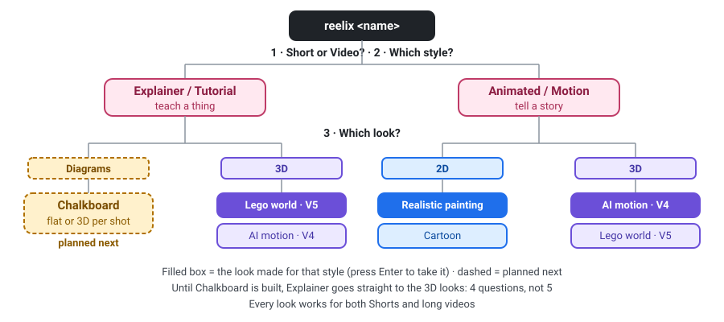
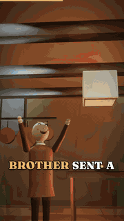

# REELIX — simple AI video maker for YouTube

Give it a name and one sentence; it makes the whole video, thumbnail and upload text with free local models.

```bash
scripts/setup.sh           # once: installs tools + all models (see SETUP.md)
reelix the-smoke-idea      # asks: what about? short or video? explainer or animated? which look? -> runs everything
reelix viral-ideas 10 space history   # 10 viral YouTube Video/Shorts ideas backed by live view data; pick one to make it
reelix list-ideas 5        # saved ideas with no video yet (oldest first); pick one to make it
reelix help                # every command with examples
```
Inside Claude Code: `/reelix the-smoke-idea`.

## What you can make
Three questions: **Short or Video**, **which style**, **which look**. The style decides which looks you are offered, so
every style gets the looks made for it.



### The four looks, side by side
| Realistic painting | Cartoon | 3D AI motion · V4 | 3D Lego world · V5 |
|:--:|:--:|:--:|:--:|
|  |  |  |  |
| 2D · FLUX.1 schnell | 2D · FLUX.2 klein | 3D · klein + Wan 2.2 | 3D · built in code |

*Real clips from made videos, except Cartoon (klein pictures cutting, since no cartoon video is made yet).*

### Explainer / Tutorial — teach a thing
| Look | How it is made |
|---|---|
| **Chalkboard / Diagrams** — planned next | Manim diagrams, arrows, labels and equations that draw themselves in time with the voice. **Each shot picks flat or 3D for itself**: flat for graphs, timelines and arrows; 3D for objects with real shape, orbits, rotation and cutaways. No API key. |
| **3D Lego / toy world** — V5 *(best today)* | A little world acting the idea out. Precise, cheap (~40 min for a Short) and easy to control |
| **3D animated (AI motion)** — V4 | Pixar-like scenes. Slower (~2 h) and its motion is loose, so it is the weaker choice when a shot must show an exact thing |

Until Chalkboard is built, Explainer goes straight to the 3D looks, so it asks 4 questions instead of 5.

### Animated / Motion Graphics — tell a story
| Look | How it is made |
|---|---|
| **Realistic painting** | 2D · FLUX.1 schnell pictures, per-video characters, camera moves, 2.5D parallax, kinetic text |
| **Cartoon** | 2D · FLUX.2 klein 4B pictures, same pipeline |
| **3D animated (AI motion)** — V4 *(best today)* | 3D · Each character gets a **hero picture** first; every shot is drawn with it as reference, so the same character appears throughout. Wan 2.2 TI2V-5B (FastWan, Apache-2.0) then animates each shot: ~12-15 min per 3-4 s shot on a 16 GB Mac. Each shot has a **speed plan** (hurry, ramps, normal; `tools/speed_ramp.py`). Clips are colour-matched per scene, given one balanced grade and AI-upscaled 3x (`tools/grade.py`) |
| **3D Lego / toy world** — V5 | 3D · No AI pictures: the set-builder agent builds the world in Three.js from `library/templates/toy3d-kit.tsx`. Smooth toy people with human proportions who **breathe, blink and shift weight by themselves**, 8 expressions, head-first turns, anticipation, jumps, sitting, children, fingers; animals by body plan (15 ready: dog, cat, horse, cow, elephant, birds, fish...); **everyday objects from a 604-model CC0 library** (trees, rocks, mountains, houses, cars, trucks, buses, trains, boats, a bicycle) repainted in the same toy plastic; glowing fire, molten glass. `tools/smooth3d.py` keeps soft things smooth and rigid things crisp |

Every look works for both Shorts and long videos. Which look belongs to which style lives in `config/looks.json`
(`styles`, `best`, `planned`).


### How long

| Format | Lengths | How to pick |
|---|---|---|
| Short (9:16) | 30, 60, 90 or 120 seconds | question 2, or `--length 60` |
| Video (16:9) | about 2.5, 5 or 10 minutes, or your own length from 1.5 to 12 minutes | question 2, or `--length long`, `--length 7` |

The longer it is, the deeper the research (more sources, facts confirmed twice), the more chapters, and the longer it takes to make.

Captions (the spoken words drawn on the video) are **off** by default. Add `--captions` to show them; they sit in the bottom band (video: bottom ~18%, subtitle size; Short: bottom ~28%), never over the action. In FE-Reelix it is the Captions Off / On switch in the Create dialog. Labels (scene label and shot labels) always sit in the top band, so no text covers the animation.

## Pipeline
| Step | Who | Makes |
|---|---|---|
| Research & script | script-writer agent (yt-script / video-marketing skills) | research.md, script.json |
| Storyboard | storyboard-artist agent (create-video-storyboard) | storyboard.json |
| Pictures | FLUX.1 schnell or FLUX.2 klein, checked by visual-artist agent (create-image-campaign) | assets/images |
| 3D looks only | AI motion: hero pictures -> Wan 2.2 -> speed plan + grade. Lego: set-builder agent builds every shot in code | assets/clips, project/custom |
| Voice, captions, music | Kokoro, whisper.cpp, ACE-Step | assets/voice.wav, captions.json, music.wav |
| Render + self-check | Remotion engine, animator agent (remotion skills) | final.mp4, review.md |
| Thumbnail | thumbnail-designer agent (youtube-thumbnail) + FLUX | thumbnail.png, youtube.md |

Every step writes one file; re-running `reelix` / `node cli/pipeline.mjs <folder>` skips finished steps. Delete a file to redo that step.

## Folders
- `bin/reelix` – the command. `cli/` – questions, progress panel, pipeline.
- `docs/experiments/` – every test with its STATS.md, on the maker's Mac only (not in git).
- `.claude/agents/` – the agents (+ producer). `.claude/skills/` – downloaded skills, unmodified (see SOURCES.md).
- `tools/` – one small script per model (`grade.py`, `speed_ramp.py`, `smooth3d.py`, `wan_i2v.py`...). `config/` – model paths (models stay in AI Video Editor), formats, channel voice.
- `library/templates/toy3d-kit.tsx` – the shared Lego kit. `library/models/` – the 3D model library (1,572 free CC0 models from Kenney, Quaternius, KayKit and poly.pizza: city streets and buildings, vehicles, food, furniture, farm, space, castle, insects, and 12 animated animals that walk, gallop and eat; the files are downloaded by setup with `python3 tools/model_library.py fetch`, the catalog `library/models/catalog.txt` is in git). Objects are taken from it first; an object no kit has is built once and saved in `library/props/` for the next video. `library/sfx/` – generated sound effects plus 169 recorded Kenney sounds (footsteps, glass, doors, jingles...). `library/icons/`, `library/maps/`, `library/peeps/`, `library/chalk/fonts.json` – icons, Natural Earth maps, Open Peeps people and handwriting fonts for the 2D and Chalkboard looks (`tools/map.py`, `tools/peeps.mjs`). `templates/remotion/` – the shared render engine. `videos/<date>-<name>/` – everything for one video.

## Viral ideas
`reelix viral-ideas [count] [topic]`: the default is 5 ideas in the channel niche (`config/voice.md`).
1. `tools/trends.py` looks at YouTube (yt-dlp, free): the most-viewed Videos this month and year, plus the topic's Shorts, ranked by views per day.
2. The **idea-scout** agent adds web research and uses the youtube-shorts, youtube-long-form, trend-jacking, idea-generation, viral-reverse-engineering and hook-writer skills.
3. It prints each idea's title, hook, why it could go viral, proof, Short/Video and a score, and saves them to `ideas/`. Pick one and it starts `reelix` with the answers already filled in.
4. `reelix list-ideas [count]` shows saved ideas that have no finished video yet, oldest first (default 5), and starts one when you pick it.
5. Ideas you pick are remembered in `.claude/agent-memory/idea-scout/picks.md`.

## Agents and models
Each agent has a model list in `.claude/models.json`. The first model runs; if it hits a usage or rate limit or is overloaded, the same job re-runs on the next model. Effort and a turn cap keep simple jobs cheap.
| Agent | Models (in order) | Effort |
|---|---|---|
| script-writer | Fable 5.1 → Opus → Sonnet → Haiku | high |
| storyboard-artist, reviewer | Opus → Sonnet → Fable → Haiku | high |
| set-builder | Opus → Fable → Sonnet → Haiku | high |
| idea-scout | Opus → Sonnet → Fable → Haiku | medium |
| animator, visual-artist | Sonnet → Opus → Haiku → Fable | medium |
| producer, sound-designer, thumbnail-designer | Sonnet → Haiku → Opus → Fable | low |
