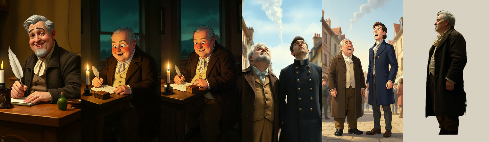

# FLUX.2 klein 4B vs FLUX.1 schnell (2026-11-14)

Test: redraw two shots of `the-smoke-idea-4` whose characters drifted with schnell, using the same prompts (`prompt-*.txt`), size 576x1024 and seed 778.
Reference pictures: the video's character cut-outs (Joseph = a side view, Etienne = three-quarter view).

Left to right: desk shot (schnell, klein without a reference, klein with Joseph's reference), brothers shot (schnell, klein with both references), Joseph's reference.

| | schnell (v4) | klein |
|---|---|---|
| Joseph at the desk (s3_2) | grey goatee, slim, older | clean-shaven, short and stocky, round belly, ruddy: matches the locked look |
| The brothers (s4_2) | Joseph with a grey beard, same height as Etienne | Joseph clean-shaven, short and stocky; Etienne tall and slim in the navy coat |
| Time per picture | ~75 s | 43 s without a reference, 82 s with 1, 123 s with 2 |
| Look | realistic painting | cartoon / Pixar-like |
| Memory | | 3.9 GB peak |
| Licence | Apache-2.0 | Apache-2.0 (the 4B only; the 9B is non-commercial) |

Findings
- klein follows the character text much better (facial hair, build, height), and is faster without a reference.
- The reference image changed little: with and without `joseph.png` gave near-identical pictures (the reference was a side view).
- The two models have different looks, so one video should use one model.
- Apple Vision face scores are not meaningful across looks (cartoon vs realistic reference); judge by eye.

Files: `schnell-*.jpg`, `klein-k32txt.jpg` (no reference), `klein-k32ref.jpg` (Joseph's reference), `klein-k42ref.jpg` (both references).
